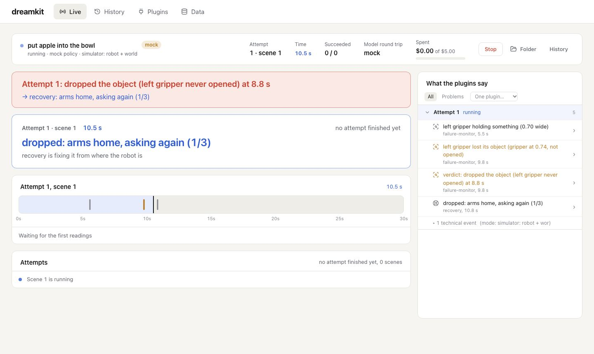
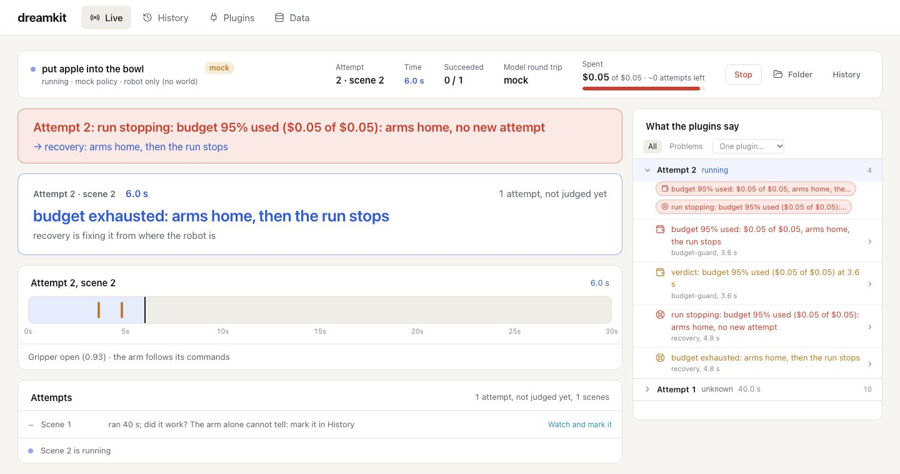

# dreamkit

[](https://github.com/chlorei/hackathon26/actions/workflows/tests.yml)

**dreamkit wraps your Dream-1 client in one line and shows why attempts fail, rescues them, counts what they cost
and collects the data to fine-tune on.**

```bash
git clone https://github.com/chlorei/hackathon26.git dreamkit && cd dreamkit
uv venv --python 3.12 .venv && source .venv/bin/activate && uv pip install dreamlabs -e ".[dev]"
./demo.sh        # opens the panel; on Live, "Try demo" runs a free simulated arm (no keys, no credits)
```

Measured on a clean clone (macOS, 2026-11-22): clone 3 s, install 18 s with an empty package cache, the demo's
three attempts 107 s. Python 3.11–3.13 and [uv](https://docs.astral.sh/uv/) needed; details in [Install](#install).



| What hurts when you run Dream-1 | What dreamkit does about it |
|---|---|
| A camera goes black or freezes and the model keeps acting on it | **camera-check** flags it before the next model call; **recovery** stops the arm |
| An attempt failed, and nobody knows why or when | **failure-monitor** names the cause and the second ("dropped the object at 8.8 s"), with the video there; **vision-judge** says from the camera whether the task was done |
| Attempts fail half the time | **recovery** takes over from where the arm is (arms home and ask again, or open and lift) instead of a scene reset; **reliability** gives the success rate with its interval and an A/B with proof |
| The credits run out mid-run | **budget-guard** warns at 50% and 80%, and at 95% sends the arms home and stops the run |
| Recording demonstrations for fine-tuning | **harvester** turns good attempts into LeRobot datasets that pass Dream Labs' `validate_dataset`; the **Data** tab records, checks, uploads and fine-tunes (`dreamkit datasets train`) |

**Results** (6 real Dream-1 runs, 172 attempts — 30% success where the model worked — and 12 recorded scenarios): [docs/RESULTS.md](docs/RESULTS.md) ·
**[Robustness](#robustness)** · **Video:** VIDEO_LINK · **Slides:** SLIDES_LINK

## How it fits

dreamkit runs **inside your own control loop**: one line wraps Dream Labs' client, and the plugins run around each
model call and each control step. Everyone who drives a robot with Dream-1 writes the same code around the model —
camera checks, retries, logs, "did it actually work?" — dreamkit makes each a plugin you switch on, in three
stages: **Detect → Recover → Learn**.

```python
import dream, dreamkit

client = dreamkit.wrap(dream.DreamClient(), config="dreamkit.yaml")   # the one line
client.policy({"checkpoint": "dreamlabs/dream-1-beta"})

with client.episode("put apple into the bowl", env=env):     # one attempt
    while client.t < 60:
        client.set_observation(frames, observation)             # as before
        reply = client.get_action()                             # plugins run around the model call
        for left, right in rows(reply):
            env.step(left, right)
            client.step(env, images=env.images(), command=(left, right))   # plugins that read the robot
client.close()
```

On a real robot, give `step()` what the robot reports instead of `env` (see [On a real robot](#on-a-real-robot)).
Without changing a line of an existing program: `dreamkit run -- python my_loop.py` patches `dream.DreamClient` in it,
and `dreamkit sim` opens Dream Labs' simulator REPL with the plugins on. The panel (`dreamkit ui`, port 8800) never
starts a run of its own besides the demo: it watches your loop (Live), manages plugins, and keeps the history with
videos, recaps and datasets. Keys go in `.env` next to `dreamkit.yaml`: `DREAM_API_KEY` for Dream-1,
`GEMINI_API_KEY` (or `ANTHROPIC_API_KEY`) for vision-judge and the Create tab. `.env` is never committed.

> **About `--mock`.** The mock policy is a scripted arm that **fails on purpose** — it drops the apple, grasps air,
> lets go off target, stalls, hits the table — so every plugin can be built and tested without the model or credits.
> Its numbers say that the *mechanism* works, nothing about Dream-1. Mock runs carry a **mock** badge in the panel.
> Real numbers come from runs without `--mock` ([docs/RESULTS.md](docs/RESULTS.md)).

## On a real robot

dreamkit does not need the simulator. Give `step()` what your robot reports instead of an env:

```python
with client.episode("put apple into the bowl", state=read_state()):
    while client.t < 60:
        client.set_observation(frames, observation)
        reply = client.get_action()
        for left, right in rows(reply):
            robot.command(left, right)
            client.step(state=read_state(),          # {"left": 6 joints + gripper, "right": …}
                        images=read_cameras(),       # optional, for camera-check / recorder / harvester
                        command=(left, right))
```

Plugins then see `ctx.robot` (joints, gripper, command vs measured, tracking error, cameras, model latency) but no
`ctx.world` (positions, contacts). What changes:

| | simulator (`env=`) | real robot (`state=`) |
|---|---|---|
| failure-monitor | all reasons, precise times | `grasped_air` (the fingers met), `dropped` (holding, then the fingers closed in without being told to open), `collision` (the arm can't follow a steady command), `stalled`, `camera_failure`; `slow_model` as a warning |
| success-check | measured | unknown: ✓ / ✗ in History, or `client.label(True)` from your loop |
| recovery | arms home via the simulator's own path; lift 5 cm on grasped air | eases to `home_joints_rad`; opens the gripper on grasped air |
| harvester | success/ and failed/ | unlabeled/ until labelled, then moved |
| plugins with `needs: [robot, world]` | on | off, marked **sim only** |

Try it without a robot: `python examples/sim_loop.py --mock --no-world` gives dreamkit only state, cameras and
commands from the simulator, exactly what a robot would. `python examples/world_vs_robot.py --mock` judges the same
attempts both ways:

```
attempt                with world                   robot only (state, gripper, commands)
success                success                      unknown (to label)
dropped                dropped @9.7s                dropped @9.6s
grasped_air            grasped_air @5.3s            grasped_air @5.3s
released_off_target    released_off_target @9.7s    unknown (to label)
not_reached            not_reached @4.6s            grasped_air @5.2s
stalled                stalled @2.2s                stalled @2.2s
collision              collision @4.0s              collision @4.0s
fell_off_table         fell_off_table @8.8s         dropped @8.1s
```

(Mock: the failures are scripted on purpose. Where the robot cannot know — where the fruit landed, whether it is in
the bowl — it says unknown instead of guessing.)

## Install

You need **Python 3.11–3.13**, **git** and **[uv](https://docs.astral.sh/uv/)**
(`curl -LsSf https://astral.sh/uv/install.sh | sh`); Node 20+ only to rebuild the web panel. macOS or Linux.

```bash
git clone https://github.com/chlorei/hackathon26.git dreamkit && cd dreamkit
uv venv --python 3.12 .venv && source .venv/bin/activate
uv pip install dreamlabs -e ".[dev]"     # Dream Labs' client, station and YAM simulator from PyPI, and dreamkit
dreamkit init                            # dreamkit.yaml with the default plugins (an existing one is kept)
```

Note: `pip install dreamkit` from PyPI is a **different project**; install dreamkit from this repository as above.
The simulator comes with the `dreamlabs` package. If you work from a checkout of Dream Labs' repository instead,
set `sim_path` in `dreamkit.yaml` to `<dreamlabs>/dream_library/examples/yam_mujoco`.

**Add-ons** (in `plugins-external/`, installed on demand; `dreamkit init` lists them commented out until then):

```bash
dreamkit install vision-judge      # judges success from the camera (GEMINI_API_KEY or ANTHROPIC_API_KEY)
dreamkit install gripper-check reliability
```

**Check it works** (no API key, no credits):

```bash
./demo.sh                                          # the panel, then Live -> Try demo
python examples/sim_loop.py --mock --episodes 2    # the same loop in the terminal
pytest -q && dreamkit check --all                  # every test, every plugin against the standard
```

**Dream-1 itself** needs an API key from [platform.dreamlabs.ai](https://platform.dreamlabs.ai/api-keys), in
`~/.dreamlabs/credentials` (the file the platform's Setup page gives you) or as `DREAM_API_KEY` in `.env`. Every
model call uses credits.

## Use

```bash
python examples/sim_loop.py --mock          # Dream Labs' simulator loop with dreamkit.wrap, scripted failures (free)
python examples/sim_loop.py --episodes 10   # the same with Dream-1 (uses credits)
python examples/sim_loop.py --mock --behaviors dropped,grasped_air,released_off_target,success \
       --fault-camera top --fault-episode 4 # the demo: every plugin gets something to do
python examples/recovery_ab.py --episodes 10  # Dream-1, same seeds with and without recovery (uses credits)
python examples/ab_test.py --tune --episodes 10   # prompt tuner: paraphrases of the task, same seeds, ranked with proof
python examples/ab_test.py --models dreamlabs/dream-1-beta,<fine-tune id> --episodes 20   # base vs fine-tune
dreamkit ui                                 # the panel: Live / Plugins / History
dreamkit where                              # where runs and datasets are, and how big
dreamkit datasets [check|train|status <name>]   # every dataset; check: validate_dataset (local); train: upload +
                                            # fine-tune (fine-tuning credits); status: the job, the model id when done
dreamkit migrate [--dry-run]                # older runs/, gym/, harvest/ into the data folder (moves, never deletes)
dreamkit list | search | install | new      # plugins
dreamkit review --limit 20                  # failed attempts -> labels.csv, each with its video at the failure second
dreamkit accuracy labels.csv                # after you label them: "failure-monitor: 17/20 reasons correct"
```

`examples/sim_loop.py` is the reference integration: Dream Labs' own `dream_control` functions (policy_config, feed,
capture, validate_chunk) drive the simulator unchanged; dreamkit adds `wrap`, `episode` and `step`.

## Where things are saved

One folder, `data_dir` in `dreamkit.yaml` (default `./dreamkit-data`, beside the config). `dreamkit where` prints it
with sizes; `dreamkit migrate` moves older layouts into it.

| path | what |
|---|---|
| `runs/<run-id>/run.json`, `events.jsonl` | one run (your loop, `dreamkit sim`/`run`, the Gym tab): results and the full event feed |
| `runs/<run-id>/ep003/` | one attempt: `top.mp4` … (each camera; video time = simulated time), `recap.mp4` (the key moments, captioned), `trace.json` (what failure-monitor measured), `result.json` |
| `runs/<run-id>/history/` | `summary.json` (the run in plain words), `report.html` (self-contained) |
| `runs/<run-id>/<plugin>/` | a plugin's own data, the files its page reads |
| `runs/gym-<id>/` | a Gym evaluation (base vs fine-tune on the same seeds) |
| `datasets/<name>/` | every dataset, LeRobot v2.1 (`meta/`, `data/`, `videos/`), plus `dataset.json`: source (harvester, Gym, Teleop, export), each episode's run and attempt, the `validate_dataset` result, the upload and fine-tune job, the model id |
| `datasets/harvest-<task>/` | the harvester's: each successful attempt of the task, appended as it ends |

History shows an attempt's files (*Show in Finder*) and the dataset it joined; the Data tab lists every dataset with
its source, size and status (collected → checked → uploaded → training → model id), and the storage it takes.

**Less CPU.** Switch on *Light mode* in the panel (or `light: true` in `dreamkit.yaml`): cameras are rendered at
5 fps instead of 10. Recording fewer cameras helps most: `- recorder: {cameras: [top]}`. The panel itself redraws
cameras and graphs outside React and pauses when its tab is hidden.

## Data tab (an app plugin)

DreamGym is a dreamkit **app plugin** in [plugins-external/dreamgym](plugins-external/dreamgym/README.md): the
**Data** tab of the panel, everything to fine-tune Dream-1 on your own demonstrations. **Collect** (a scripted IK
expert for free, Dream-1's own successes, or teleop; built-in tasks or one typed in your own words), **Check** (balance
per task, every episode on video, keyboard review), **Fine-tune** (Dream Labs' `validate_dataset`, then upload), and
**Compare** the fine-tune with the base model on scenes it never saw (McNemar's test). Every episode runs through
`dreamkit.wrap`, so the plugins of dreamkit.yaml work in it. On the command line it also has Arena, Compare and the
Prompt Tuner (same seeds, McNemar), with **Recovery on vs off** to measure recovery itself.

```bash
dreamkit install ./plugins-external/dreamgym     # check + tests, then pip; restart dreamkit ui -> tab "Data"
dreamkit dreamgym arena --task banana_plate --policy scripted --n 10 --recovery-ab
```

App plugins (a page, an API and commands of their own) are in [PLUGIN_STANDARD.md §13](docs/PLUGIN_STANDARD.md).

## Add plugins from GitHub

Any of these work, in the terminal or on the panel's Plugins page:

```bash
dreamkit install gripper-check                                   # a name from registry.yaml
dreamkit install you/dreamkit-my-check                           # owner/repo
dreamkit install https://github.com/you/repo/tree/main/plugins/x # a folder inside a repo
dreamkit install https://github.com/you/repo/blob/main/my.py     # a single file -> ~/.dreamkit/plugins/
dreamkit install ./my-local-plugin                               # a folder on disk
```

Then switch it on in the panel or add it under `plugins:` in `dreamkit.yaml`. A plugin is code that runs on your
machine: install what you trust.

To publish yours: `dreamkit new my-check`, edit `my_check.py`, push it to GitHub, and add an entry to `registry.yaml`
here with a pull request. `plugins-external/gripper-check/` is a complete example.

## Create a plugin by describing it

The panel's **Create** tab: say what to watch ("warn when a hand moves faster than 1.5 rad/s near the bowl"), a model
writes the plugin, and dreamkit runs it through the same filter as `dreamkit install` (the standard, its replay
tests, the 1 ms budget) before you see it; refused packages go back to the model with the problems, three tries at
most. Keep chatting to change it ("make the threshold 0.5"). **Add to catalog** puts it in `plugins-generated/<name>/`
next to `dreamkit.yaml` (listed as *generated* on the Plugins page, where Delete removes it); **Download .zip** gives
you the package. Keys come from `.env`: `GEMINI_API_KEY` (and `ANTHROPIC_API_KEY` for Claude when Gemini is out of
quota).

Generated plugins only watch: observe capability, diagnosis or safety group, no network, files or subprocesses. The
code is scanned before it runs and checked in a separate process without your API keys; it is still code a model
wrote, so read it (the Code panel) before you keep it. The checks prove it follows the standard, not that its idea
is right: a plugin can pass and still measure the wrong thing.

## The whole config

`dreamkit.yaml` says which plugins run and how — nothing else. What to run (task, attempts, model, mock, seed) is
your loop's business: `python examples/sim_loop.py --help`.

```yaml
sim_path: ../dreamlabs/dream_library/examples/yam_mujoco
data_dir: dreamkit-data      # runs/ and datasets/ (see Where things are saved)
plugins:
  - camera-check
  - failure-monitor: {slow_ms: 700}
  - recovery: {max_recoveries: 3, retry_attempts: 1}
  - recorder: {video_fps: 10}
  - harvester
```

## Built-in plugins

| plugin | what it does |
|---|---|
| `failure-monitor` | why and when an attempt failed, first cause in time: `dropped` (the gripper never opened), `released_off_target`, `grasped_air`, `not_reached`, `collision`, `fell_off_table`, `stalled`, `slow_model` (model latency), `camera_failure`, `timeout`; live verdicts mid-attempt |
| `recovery` | the one control plugin. On a live verdict: arms home (`yam_env.home_path`) + `reset_episode()` + same prompt; grasped air: open, lift 5 cm, continue; `camera_failure`: stop; then retry the scene (`retry_attempts`) |
| `harvester` | every attempt as LeRobot v2.1 (state/action: right arm, right gripper, left arm, left gripper; videos overhead / wrist_l / wrist_r) |
| `success-check` | an **evaluation tool**, simulator only: object in the bowl / on the plate with the gripper released → success. It reads the simulator's world, so it never runs in the working loop; the demo, `sim_loop --with-world` and the tests use it |
| `recorder` | MP4 per camera per attempt; video time = simulated time, so `ep003_top.mp4#t=9.3` is the moment |
| `camera-check` | flags a black, uniform or frozen camera before the next model call; recovery stops the robot |

Examples of external plugins in `plugins-external/`: `gripper-check` (observe) and `safety` (modify_actions: a joint
speed cap and a workspace box — it may only make a chunk stricter). Recaps, the run summary and the report are part
of **History**, made by the core for every run.

Every threshold is a plugin setting: on the Plugins page, or `- failure-monitor: {reach_m: 0.05}`.

## Write a plugin

Every plugin follows [docs/PLUGIN_STANDARD.md](docs/PLUGIN_STANDARD.md) — and cannot do otherwise: a plugin that
breaks it does not import, and the error says the rule, the file:line and the fix.

```bash
dreamkit new hand-distance --kind observe      # or modify / control: a package that already passes everything
dreamkit check dreamkit-hand-distance          # manifest, Params (descriptions, units), docstring, names
dreamkit test dreamkit-hand-distance           # replay tests: no simulator, no model, no credits
dreamkit bench dreamkit-hand-distance          # ms/step on all 12 bundled fixtures, budget 1 ms
dreamkit install ./dreamkit-hand-distance      # check + test + bench first, then pip install; refused otherwise
```

```python
from pydantic import BaseModel, Field
from dreamkit import Manifest, Plugin


class Params(BaseModel):
    closed_cmd: float = Field(0.3, ge=0, le=1, description="Gripper command below which it is shut",
                              json_schema_extra={"unit": ""})
    settle_s: float = Field(0.6, ge=0, description="How long the fingers get to close",
                            json_schema_extra={"unit": "s"})


class GripperCheck(Plugin):
    """Catches a gripper closed on nothing and a grip that loosens mid-carry."""

    name = "gripper-check"
    Params = Params
    manifest = Manifest(group="diagnosis", icon="Hand", capability="observe",
                        hooks=["on_episode_start", "on_step"], step_rate_hz=10)

    def on_episode_start(self, ctx):
        self.closed_at = None

    def on_step(self, ctx):
        if ctx.world.grip("right") < 0.04:                      # ctx.world: pos, tcp, grip, contacts, table_z
            ctx.emit("warn", "right gripper closed on nothing")   # checked: level, form, units, 1/s
            ctx.ui.mark(ctx.t, "closed on nothing", "warn")      # the panel's timeline
```

What a plugin may do depends on its capability: `observe` reads (and reports failures with `ctx.verdict`),
`modify_actions` may only make the chunk stricter (the manager rejects anything faster or outside joint limits),
`control` may stop, retry or drive the arms — and only one control plugin (`recovery`) is on at a time. Files go to
`run_dir/<plugin>/` through `ctx.files`, slow work through `ctx.defer`, the UI through `ctx.ui.*`. Every hook is timed;
5 errors in a row or a plugin over its 1 ms/step budget three times is switched off, and the panel says why.

Fixtures for tests: `dreamkit.testing.replay("dropped_mid_carry", plugins=["failure-monitor"])`; record new ones from
the simulator with `dreamkit record my_case --mock --behavior grasped_air`.
`dreamkit bench failure-monitor --accuracy` scores the verdicts on the whole fixture library (12/12 today).

## Rules we keep

The robot is Dream Labs' as shipped: dreamkit never edits the simulator's files, the arm model or the cameras, and
every chunk goes through `dream_control.validate_chunk` in the loop after the plugins. Plugins may only tighten
actions; the example loop only moves the fruit (scene randomisation).

## How it works

```
 your control loop (sim or robot)                       the panel — dreamkit ui (FastAPI :8800 + React)
 ─────────────────────────────────                      ────────────────────────────────────────────────
 client = dreamkit.wrap(DreamClient)                     Live     watches the run being written
   │ get_action()  step()  episode()                     Plugins  dreamkit.yaml + each plugin's status
   ▼                                                     History  videos, verdicts, recaps, datasets
 PluginManager ── order, one control plugin,                 ▲
   │              budget, errors, scoped ctx                 │ reads files only — never your process
   ▼                                                         │
 plugins ── failure-monitor → recovery → harvester …         │
   │        (ctx.world, ctx.ui, ctx.files, ctx.defer)        │
   ▼                                                         │
 runs/<id>/  run.json  events.jsonl  live/  ep003/  history/ ┘
```

1. **wrap** — `dreamkit.wrap(dream.DreamClient())` is the same client; `get_action()` runs `before_model` / `after_model`
   around the model call, `step()` runs `on_step` after each executed row, `episode()` opens and closes an attempt.
2. **manager** — loads plugins by the standard (requires, conflicts, one control plugin), gives each a context scoped to
   its capability, times every hook and switches off a plugin that keeps failing or runs over budget.
3. **plugins** — measure, decide, act (only `recovery` acts), save an attempt's files in `runs/<id>/ep003/`; the
   harvester adds successful attempts to `datasets/harvest-<task>/`.
4. **runs/** — the run folder is the only interface: events, live frames, a heartbeat, results, videos.
5. **panel** — follows that folder, so your loop never depends on it: open or close it any time, over SSH too.

## Robustness

**184 tests · 12 recorded scenarios · run offline** — no simulator, network, model or keys needed for the
[CI run](https://github.com/chlorei/hackathon26/actions/workflows/tests.yml) on every push (tests that need the
simulator skip themselves there and run locally).

| What | Where | Check it yourself |
|---|---|---|
| **A plugin cannot break the robot's loop.** An exception becomes an error event; 5 in a row and the plugin is switched off. A step that averages over 1 ms, 3 windows of 100 steps running, and it is switched off; slow work goes to `ctx.defer`. | [`manager.py`](dreamkit/manager.py), [`tests/test_core.py`](tests/test_core.py) | `pytest tests/test_core.py` |
| **A plugin can only do what its capability allows**: an observer cannot stop the arm, a modifier may only make a chunk stricter (slower, inside limits), one control plugin at a time, each writes only its own key of the result. | [`plugin.py`](dreamkit/plugin.py), [`tests/test_standard_enforcement.py`](tests/test_standard_enforcement.py) | `pytest tests/test_standard_enforcement.py` |
| **The standard is checked at import**: a plugin that breaks [PLUGIN_STANDARD.md](docs/PLUGIN_STANDARD.md) does not even import, and the error says the rule, the file:line and the fix. | [`standard.py`](dreamkit/standard.py) | `dreamkit check --all` |
| **budget-guard stops before the credits run out**: at 95% of the budget the arms go home and the run ends. | [`budget_guard`](dreamkit/plugins/budget_guard/plugin.py), [`tests/plugins/test_budget_guard.py`](tests/plugins/test_budget_guard.py) | budget-guard with `budget_usd: 0.05, count_mock: true`, then `python examples/sim_loop.py --mock --episodes 6` |
| **When the model fails, the loop goes on**: a model error ends that attempt with a reason; 5 in a row and recovery stops the run instead of spinning. A camera judge without a key or quota writes *not judged* and the run continues. | [`recovery`](dreamkit/plugins/recovery/plugin.py), [`llm.py`](dreamkit/llm.py), [`tests/plugins/test_recovery.py`](tests/plugins/test_recovery.py) | `dreamkit install vision-judge`, then without `GEMINI_API_KEY`: `python examples/sim_loop.py --mock --episodes 1` → *not judged: GEMINI_API_KEY is not set* |
| **When Dream-1's servers are full, the run stops itself.** Real run `20261122-160346-2fd1`: the API answered `DA-2000 NO_CAPACITY` 5 times in a row, and recovery ended the run (*5 attempts in a row ended in a model error: the run stops*) instead of spinning. | [`recovery`](dreamkit/plugins/recovery/plugin.py), [`tests/plugins/test_recovery.py`](tests/plugins/test_recovery.py) | `pytest tests/plugins/test_recovery.py` |
| **A broken camera is caught**: black, uniform or frozen, before the next model call. | [`camera_check`](dreamkit/plugins/camera_check/plugin.py), [`tests/plugins/test_camera_check.py`](tests/plugins/test_camera_check.py) | `python examples/sim_loop.py --mock --fault-camera top --fault-kind black` |
| **Mock and replay need no network and no credits**: the scripted arm in the simulator, and 12 recorded attempts every plugin test replays. | [`mock.py`](dreamkit/mock.py), [`testing.py`](dreamkit/testing.py), [`dreamkit/fixtures/`](dreamkit/fixtures) | `pytest -q` |
| **Generated plugins pass the same checks as installed ones** (`dreamkit check`, its replay tests, the 1 ms bench) and a scan of the code: no network, files outside its folder, subprocesses or dynamic code. Honestly: a filter, not a sandbox — read the code before you keep it. | [`create.py`](dreamkit/create.py), [`tests/test_create.py`](tests/test_create.py) | `pytest tests/test_create.py` |
| **A plugin's page runs in a sandboxed iframe** and reads only its own folder of the run, `run.json` and `events.jsonl`. | [`server.py`](dreamkit/server.py), [`tests/test_plugin_page.py`](tests/test_plugin_page.py) | `pytest tests/test_plugin_page.py` |



## What didn't work

- **The camera judge missed failures between its frames.** Judging an attempt from its last frame (or a few) misses
  an apple dropped and picked up again; it now judges each try that recovery cut short on its own, and needs key
  frames around the moments failure-monitor marks, or more frames.
- **Free Gemini quotas.** About 20 requests a model a day: on a long run most attempts went *not judged*
  (129 of 172, see [RESULTS](docs/RESULTS.md); `dreamkit judge --all-unjudged` judges them again later). The judge falls back across models and to Claude, and says *not judged*
  instead of guessing.
- **Create writes plugins with a model, and checks them with a filter, not a sandbox.** A weaker model often needs a
  second or third try to pass the checks.
- **Fine-tuning takes 7–8 hours** on Dream Labs' side, so we could not close the loop (collect → fine-tune → measure)
  within the hackathon.
- **What a real arm cannot tell.** From joints, gripper and commands alone, *released off target* and *never reached*
  look like other failures; in the simulator only the world can name them (failure-monitor: 8 of 12 recorded
  scenarios, see [RESULTS](docs/RESULTS.md)).

## What's next

- Key frames for the camera judge around failure-monitor's marks, and its accuracy measured on labelled attempts.
- A finished fine-tune measured against the base model on the same scenes (the Data tab's Evaluate, McNemar).
- A real robot: the same plugins on what a real arm reports (they already need nothing else), and a person's ✓/✗ in
  History where nothing can judge.
- Create in a real sandbox (a container without network) instead of a code filter.

## Troubleshooting

| Problem | What to do |
|---|---|
| *not judged: GEMINI_API_KEY is not set* | Put `GEMINI_API_KEY=…` (or `ANTHROPIC_API_KEY=…`) in `.env` next to `dreamkit.yaml`, or mark attempts ✓/✗ in History. The run is not affected. |
| *Gemini quota exhausted* / 429 | The free tier allows about 20 requests a model a day; it resets the next day. Add `ANTHROPIC_API_KEY` to `.env` to fall back to Claude. The panel's Create tab shows today's calls per model. |
| Live is empty: *No robot running yet* | Nothing is running: click **Try demo** (free), or start your loop. If the demo does not start, the page shows its last lines and what to do. |
| *Dream Labs simulator not found* | `uv pip install dreamlabs` (the simulator comes with it), or set `sim_path` in `dreamkit.yaml` to a checkout's `dream_library/examples/yam_mujoco`. |
| *port 8800 is already in use* | Another `dreamkit ui` is running (open http://127.0.0.1:8800), or use another port: `dreamkit ui --port 8801` (`PORT=8801 ./demo.sh`). |

## Develop the panel

```bash
cd ui && npm install
npm run dev        # http://localhost:5173, proxies the API to `dreamkit ui` on :8800
npm run build      # writes dreamkit/ui_dist/, which `dreamkit ui` serves
```
