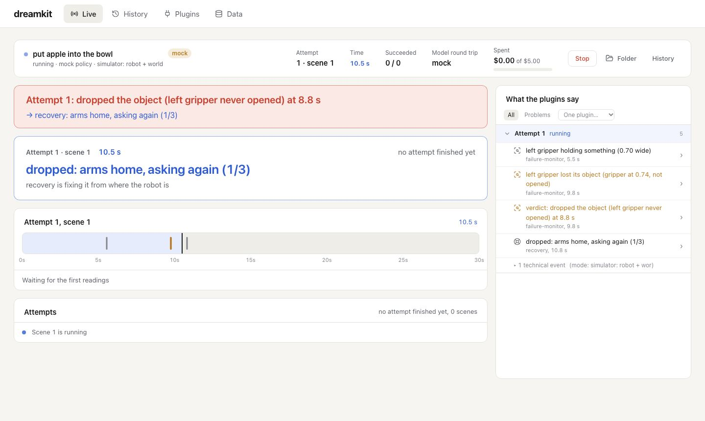
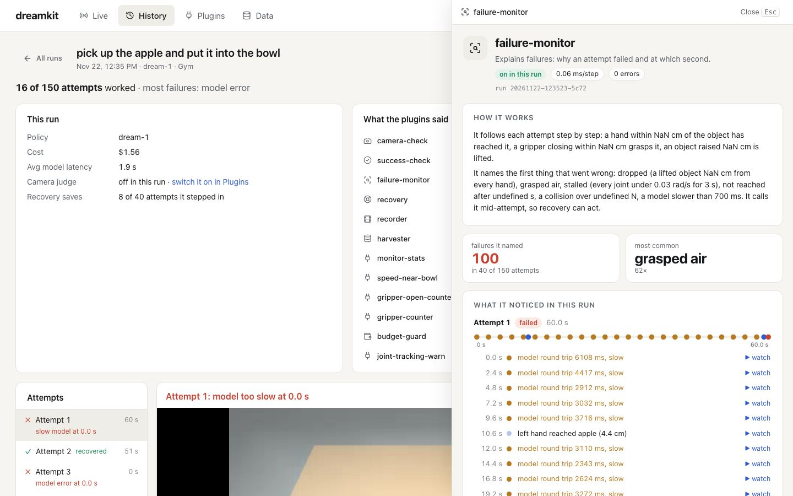
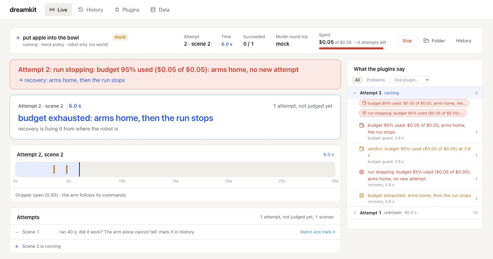
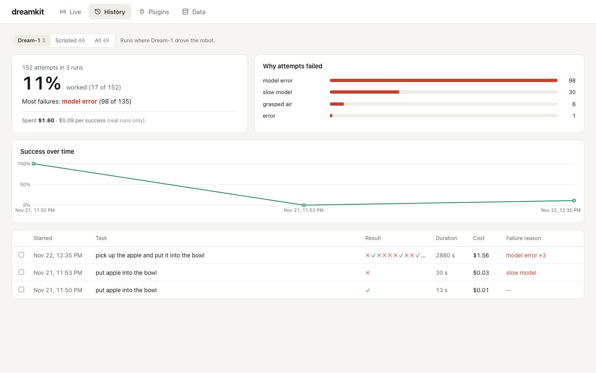

# Results

What dreamkit measured, on real Dream-1 runs and on recorded scenarios. Every number below has the date it was
measured and the command that gives it again. Nothing here is estimated.

**How much real data there is:** 7 runs with Dream-1 in Dream Labs' MuJoCo simulator, **178 attempts**, on
2026-11-21 and 2026-11-22. Enough to see where attempts go wrong and what they cost; too few to rank models or
prompts with confidence (see the intervals).

**Conditions of these runs.** The team's Dream-1 API credits arrived only on the second day of the hackathon.
During the final runs the Dream-1 API often answered *pool full* / `DA-2000 NO_CAPACITY` under the hackathon's load,
and our own network dropped for a stretch of one run. dreamkit counts these as server/network refusals, not as
failures of the model, and recovery stopped one run by itself after 5 refusals in a row. The success rate
(**33%, 24 of 72**) counts only attempts where the model actually ran; the judge's accuracy (**80%, 37 of 46**)
counts only attempts that both the camera judge and the simulator judged.

The run folders (videos, frames, about 1 GB) stay on our machine. One row per attempt is in git:
[`docs/results/dream1-attempts.json`](results/dream1-attempts.json) (no messages, addresses, session ids or paths).

```bash
python tools/results.py          # every number in sections 1–2, from that file
```

## 1. Dream-1 in the simulator

Measured 2026-11-22 with `python tools/results.py`. Success was decided by the simulator (success-check). The
150-attempt run was recorded through the Data tab (apple → bowl, orange → bowl, banana → plate, 24 phrasings).

**104 of the 178 attempts never reached the model**: the API refused them or could not be reached. They are
counted separately, **not** as Dream-1 failures:

| Server/network refusals | Attempts |
|---|---|
| network: could not reach the API (our connection dropped, attempts 31–123 of the long run) | 92 |
| server at max capacity (`DA-2000 NO_CAPACITY`, pool full) | 6 |
| session expired | 3 |
| timeout after 45 s | 2 |
| other loop error | 1 |

(2 more attempts were stopped by us and are left out too.)

| Dream-1, attempts where the model worked | |
|---|---|
| Success | **24 / 72 = 33%** (95% Wilson interval 24–45%) |
| apple → bowl / orange → bowl / banana → plate | 15/39 = 38% (25–54%) · 6/18 = 33% (16–56%) · 3/15 = 20% (7–45%) |
| Why the rest failed | slow model 30 (the arm waited past 700 ms for a chunk) · timeout 11 · grasped air 6 |
| Model round trip | median of per-attempt means **765 ms**, median p95 **2.11 s** (80 attempts with calls) |
| Cost | **$2.34** for 1,793 model calls → **$0.098 per success** |
| A successful attempt took | 35.7 s on average |

**By phrasing of the task** (the long run used 24 phrasings). The samples are small: most rates stand on 1–5
attempts, and their intervals overlap almost entirely, so they do **not** show that one phrasing works better.
The phrasings with at least 3 attempts:

| Phrasing | n | Success (95% interval) |
|---|---|---|
| put apple into the bowl | 23 | 8 = 35% (19–55%) |
| put orange into the bowl | 5 | 2 = 40% (12–77%) |
| place the orange fruit into the ceramic bowl | 5 | 2 = 40% (12–77%) |
| pick up the apple and put it into the bowl | 3 | 2 = 67% (21–94%) |
| grasp the red apple, lift it, and release it into the bowl | 3 | 2 = 67% (21–94%) |
| place the yellow banana onto the blue plate | 3 | 2 = 67% (21–94%) |
| 7 others with 3 attempts each | 3 each | 1 of 3 each |

The latest run (`20261122-161518-14a8`, *put apple into the bowl*): **4 of 6**. Every phrasing:
`python tools/results.py`.

## 2. What the plugins did on those runs

| Plugin | Result |
|---|---|
| recovery | stepped in on **42** attempts; **8** of them then succeeded. When Dream-1's servers were full (run `20261122-160346-2fd1`), it **stopped the run itself after 5 refusals in a row** instead of spinning |
| vision-judge (camera) vs success-check (simulator) | agreed on **37 / 46 = 80%** of the attempts both judged (in the latest run, 1 of 3). 132 not judged: 34 because its Gemini call failed (free-tier quota, 503), the rest got no verdict. `dreamkit judge --all-unjudged` judged 21 of them again later, until the quota (429) stopped it |
| budget-guard | never had to stop a real run |

## 3. Recorded scenarios (no model, no credits)

12 attempts recorded in the simulator (`dreamkit/fixtures/`), replayed through a plugin: the tests and the
benchmarks below run on these, offline.

**failure-monitor names the failure: 8 / 12** (2026-11-22)

```bash
dreamkit bench failure-monitor --accuracy
```

| Right (8) | Wrong (4) |
|---|---|
| success ×2, dropped, grasped air, stalled, collision, camera black, camera frozen | fell off table → *dropped*; not reached → *grasped air*; released off target, released near target → *no verdict* |

The four it gets wrong are exactly what a real arm's signals cannot tell: *where* the object ended up. The monitor
reads only what a real robot reports (joints, gripper, commands, cameras); the simulator's world is for evaluation
only, and `world-judge` (an evaluation tool that reads it) names those. Worst average cost: **0.014 ms per control
step**, against a 1 ms budget.

**camera-check** (2026-11-22): the top camera turned black at 5.0 s; camera-check called it at **6.0 s** and
recovery stopped the attempt.

```bash
python examples/sim_loop.py --mock --fast --episodes 1 --seconds 20 --fault-camera top --fault-kind black
```

**budget-guard** (2026-11-22): with a $0.05 budget (a mock run billed as Dream-1), it warned at 50% in attempt 1
and 80% in attempt 2, then at 95% sent the arms home and **stopped the run in attempt 2 of 6**.

```bash
# dreamkit.yaml: plugins: [failure-monitor, recovery, {budget-guard: {budget_usd: 0.05, count_mock: true}}]
python examples/sim_loop.py --mock --fast --episodes 6 --seconds 30
```

**The free demo** (Live → Try demo, 2026-11-22): a scripted arm that drops the apple on purpose in attempts 1 and
3; **3 of 3** attempts succeed, recovery saved both drops. This shows the mechanism works; it says nothing about
Dream-1.

## 4. Screenshots

| | |
|---|---|
|  |  |
| **Live**, the second the apple drops: what failed, when, what recovery does | **Live**, the demo's end: 3 of 3, two saved by recovery |
|  |  |
| **History**, the real 150-attempt run: cost, latency, what each plugin said | **A plugin's page** (failure-monitor) for that run |
|  |  |
| **budget-guard** at 95%: arms home, the run stops | **History**: success over time, compare two runs |
