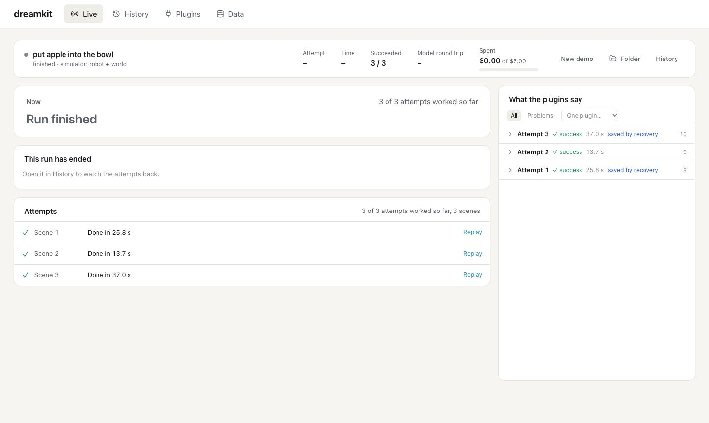
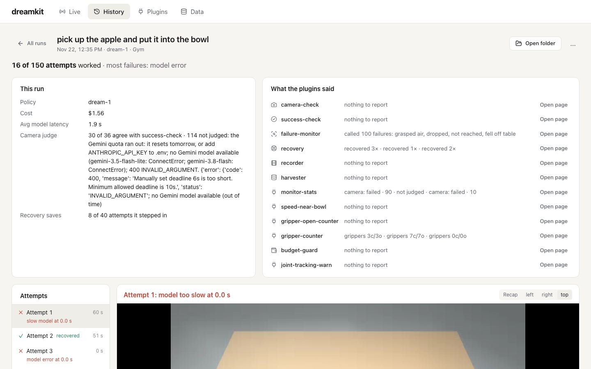

# Results

What dreamkit measured, on real Dream-1 runs and on recorded scenarios. Every number below has the date it was
measured and the command that gives it again. Nothing here is estimated.

**How much real data there is:** 3 runs with Dream-1 in Dream Labs' MuJoCo simulator, **152 attempts**, on
2026-11-21 and 2026-11-22. That is enough to see where the attempts go wrong and what they cost; it is too few
to rank models or prompts with confidence (see the intervals).

The run folders (videos, frames, about 1 GB) stay on our machine. One row per attempt is in git:
[`docs/results/dream1-attempts.json`](results/dream1-attempts.json) (no messages, addresses, session ids or paths).

```bash
python tools/results.py          # every number in sections 1–2, from that file
```

## 1. Dream-1 in the simulator

Runs: `20261121-235024-d6d6` (1 attempt), `20261121-235303-b226` (1 attempt), `20261122-123523-5c72` (150 attempts,
12:35–14:49, recorded through the Data tab: apple → bowl, orange → bowl, banana → plate, 24 phrasings of the task).
Success was decided by the simulator (success-check: the object rests in the target and the gripper let go).

| | |
|---|---|
| Success, every attempt | **17 / 152 = 11%** (95% Wilson interval 7–17%) |
| Success where the model answered | **17 / 53 = 32%** (21–45%) |
| apple → bowl / orange → bowl / banana → plate | 8/20 = 40% (22–61%) · 6/18 = 33% (16–56%) · 3/15 = 20% (7–45%) |
| Model round trip | median of per-attempt means **2.57 s**, median p95 **3.48 s** (59 attempts with calls) |
| Cost | **$1.56** for 1,203 model calls → **$0.092 per success** |
| A successful attempt took | 39.3 s on average |

**Why attempts failed** (failure-monitor's verdict, one per attempt):

| Reason | Attempts | What it was |
|---|---|---|
| model error | 98 | 92 *could not reach the API* (our network/DNS dropped during attempts 31–123), 3 session expired, 2 timeouts after 45 s, 1 *no capacity* |
| slow model | 30 | the arm waited for the next chunk past the 700 ms limit |
| grasped air | 6 | a gripper closed on nothing |
| error | 1 | the loop itself |

The honest reading: most failures of the long run were **ours** (the network went away: 92 of attempts 31–123
could not reach the API), not Dream-1's. dreamkit made that visible in one line instead of 98 rows; since then **recovery stops a run after 5
model errors in a row** (`stop_after_model_errors`), so such a run no longer spins.

## 2. What the plugins did on those runs

| Plugin | Result |
|---|---|
| recovery | stepped in on **40** attempts (25 × lift and continue, 15 × arms home and ask again); **8** of them then succeeded |
| camera judge (monitor-stats, now vision-judge) | judged **38** attempts, agreed with the simulator on **32 / 38 = 84%**; 114 not judged, 21 of them because its Gemini call failed (free-tier quota, network) |
| budget-guard | $1.56 of the $5.00 budget used; never had to stop |

## 3. Recorded scenarios (no model, no credits)

12 attempts recorded in the simulator (`dreamkit/fixtures/`), replayed through a plugin: the tests and the
benchmarks below run on these, offline.

**failure-monitor names the failure: 8 / 12** (2026-11-22)

```bash
dreamkit bench failure-monitor --accuracy
```

| Right (8) | Wrong (4) |
|---|---|
| success ×2, dropped, grasped air, stalled, collision, camera black, camera frozen | fell off table → *dropped*; not reached → *grasped air*; released off target, released near target → *no verdict* |

The four it gets wrong are exactly what a real arm's signals cannot tell: *where* the object ended up. The monitor
reads only what a real robot reports (joints, gripper, commands, cameras); the simulator's world is for evaluation
only, and `world-judge` (an evaluation tool that reads it) names those. Worst average cost: **0.014 ms per control
step**, against a 1 ms budget.

**camera-check** (2026-11-22): the top camera turned black at 5.0 s; camera-check called it at **6.0 s** and
recovery stopped the attempt.

```bash
python examples/sim_loop.py --mock --fast --episodes 1 --seconds 20 --fault-camera top --fault-kind black
```

**budget-guard** (2026-11-22): with a $0.05 budget (a mock run billed as Dream-1), it warned at 50% in attempt 1
and 80% in attempt 2, then at 95% sent the arms home and **stopped the run in attempt 2 of 6**.

```bash
# dreamkit.yaml: plugins: [failure-monitor, recovery, {budget-guard: {budget_usd: 0.05, count_mock: true}}]
python examples/sim_loop.py --mock --fast --episodes 6 --seconds 30
```

**The free demo** (Live → Try demo, 2026-11-22): a scripted arm that drops the apple on purpose in attempts 1 and
3; **3 of 3** attempts succeed, recovery saved both drops. This shows the mechanism works; it says nothing about
Dream-1.

## 4. Screenshots

| | |
|---|---|
|  |  |
| **Live**, the second the apple drops: what failed, when, what recovery does | **Live**, the demo's end: 3 of 3, two saved by recovery |
|  |  |
| **History**, the real 150-attempt run: cost, latency, what each plugin said | **A plugin's page** (failure-monitor) for that run |
|  |  |
| **budget-guard** at 95%: arms home, the run stops | **History**: success over time, compare two runs |
